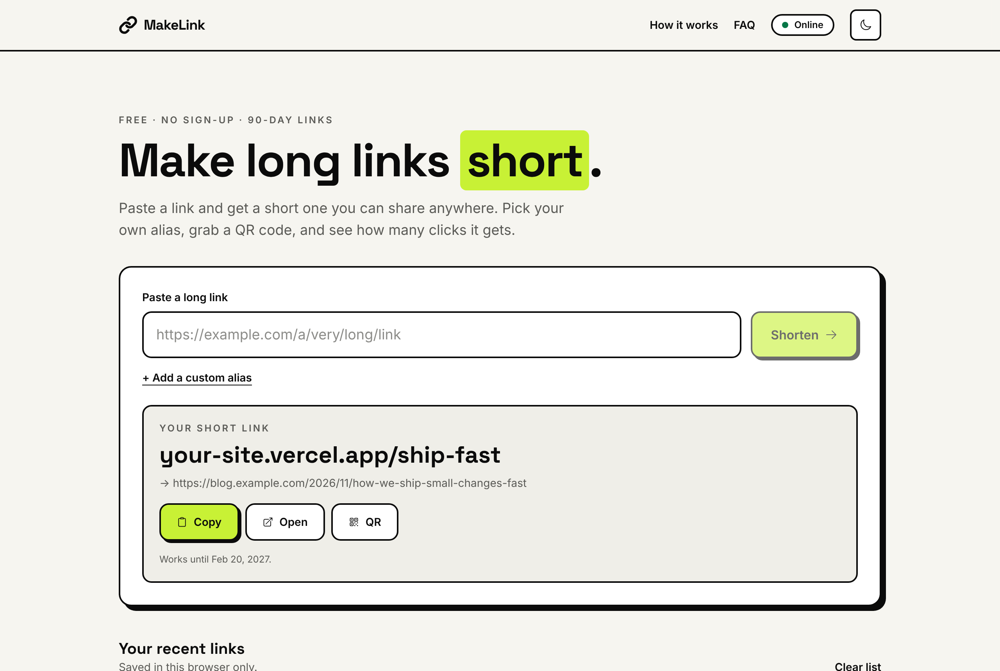

# MakeLink — URL Shortener



**MakeLink** is a free, no-sign-up URL shortener built with the MERN stack: paste a link,
get a short one, pick a custom alias, download a QR code, and see how many clicks it gets.

---

## 🚀 Deploy your own

See **[DEPLOY.md](DEPLOY.md)** for a step-by-step guide (MongoDB Atlas + Render + Vercel,
all on free plans).

---

## ✨ Features

- **One-click shortening**: paste any http/https link; `example.com` works without the `https://`.
- **Custom aliases**: pick your own short link (3–32 letters, numbers, `-`, `_`).
- **QR codes**: show and download a PNG for any new link.
- **Recent links with click counts**: saved in your browser, no account needed.
- **Light & dark mode**: follows your system, with a toggle.
- **90-day lifespan**: links are deleted automatically via a MongoDB TTL index.
- **Hardened API**: Helmet headers, per-IP rate limiting, strict URL validation, tests.

---

## 🛠️ Technologies Used

- **Frontend**: React (Vite), Tailwind CSS v4, qrcode.react
- **Backend**: Node.js, Express.js, Mongoose
- **Database**: MongoDB Atlas
- **DevOps**: Vercel (Edge Proxying), Render (API Deployment)

---

## 🔑 Environment Variables

To run this project locally, create the following files:

### Server Environment (`/server/.env`)

```text
PORT=5000
MONGO_URI=your_mongodb_atlas_uri
BASE_URL=http://localhost:5000
# Optional:
# TRUST_PROXY=1        # proxy hops in front of the API (use 2 for Vercel rewrites -> Render)
# CORS_ORIGIN=https://your-site.vercel.app   # comma-separated; defaults to *
```

`BASE_URL` is the domain short links are built on. In production set it to the
frontend domain (e.g. `https://your-site.vercel.app`) so links go through the
Vercel rewrite.

### Client Environment (`/client/.env.local`)

```text
VITE_API_URL=http://localhost:5000/api
```

---

## ⚡ Installation & Usage

To get a local copy up and running, follow these steps:

1. **Clone the repository:**

   ```bash
   git clone https://github.com/harrykhan-crypto/URL_SHORTNER.git
   ```

2. **Navigate to the root folder:**

   ```bash
   cd URL_SHORTNER
   ```

3. **Install dependencies:**

   ```bash
   npm run install-all
   ```

4. **Start the development server:**

   ```bash
   npm run dev
   ```

5. **Open your browser and visit** [http://localhost:5173](http://localhost:5173) _(or the port shown in your terminal)_.

6. **Run the API tests:**

   ```bash
   cd server && npm test
   ```

---

## 📝 Notes

- **Automatic Deletion**: This project uses a TTL index on MongoDB. All links are automatically deleted from the database exactly 90 days after creation.
- **Security Policy**: Only `http:` and `https:` destinations are accepted; `javascript:`, `data:`, `file:` and other protocols are rejected.
- **Custom Aliases**: 3–32 characters (letters, numbers, `-`, `_`), case-insensitive. A few names such as `api` are reserved.
- **Production Proxy**: In production, the `vercel.json` handles rewrites so short links use your Vercel domain. Set your Render address in `client/vercel.json` (see [DEPLOY.md](DEPLOY.md)).

---

## 🚧 Future Enhancements

- Link analytics dashboard (referrers, countries, time series)
- Password-protected links
- Custom domains
- Automatic malicious-URL screening

---

## 🙌 Credits

- **Original design & development by [Saad Shaikh](https://saad-shaikh.vercel.app/)**

---

Feel free to suggest features, report bugs, or fork the project!

---

## ⚠️ Limitation of Liability & Disclaimer

**Usage of this tool is at your own risk.**

The developer of MakeLink:

- Does **not** monitor, endorse, or verify the content of any shortened URLs.
- Is **not** liable for any damages, legal issues, or security threats (malware, phishing, etc.) arising from the use of redirected links.
- Explicitly disclaims all responsibility for user-generated content.
- Provides this software for **learning and demonstration purposes only**.

If you find an abusive link, please report it via the GitHub Issues tab.
